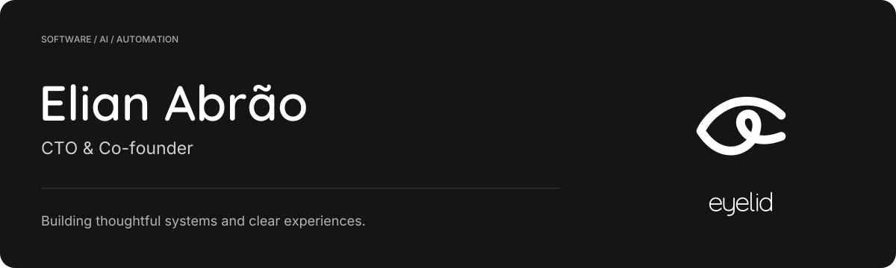

  

  <a href="https://github.com/EyelidSoftware">eyelid</a> &nbsp; · &nbsp;
  <a href="https://www.linkedin.com/in/Elian-Abrao">LinkedIn</a> &nbsp; · &nbsp;
  <a href="#selected-work">Selected work</a>

 

## Engineering with a product mindset.

I'm **Elian Abrão**, co-founder and CTO of **[Eyelid](https://github.com/EyelidSoftware)**, a software company **[Luigi](https://github.com/LuigiNeto01)** and I founded on **February 5, 2024**. We continue to work together on solutions and company decisions, with a shared focus on engineering quality, reliable delivery and user experience.

Through eyelid, I work as a **Tech Lead at TreeInova**, leading initiatives across **AI, machine learning, automation, innovation and R&D**. My role combines team leadership with hands-on work in software architecture, development and production operations.

My experience includes enterprise AI assistants, data and document integrations, and inference infrastructure. I work across the full lifecycle, from early concepts and technical decisions to deployment and ongoing maintenance, keeping the needs of the people using the software in view.

### What I work on

- **Technical leadership.** Guiding the team, setting priorities and turning business needs into validated deliveries.
- **Architecture & product engineering.** APIs, service boundaries, integrations and interfaces designed around real workflows.
- **AI & automation.** Enterprise assistants, agent tooling, inference infrastructure and automation systems.
- **Production & operations.** Linux, Docker, deployment workflows, observability and ongoing maintenance.

## Selected work

| Project | What it explores |
| :--- | :--- |
| **[Argus](https://github.com/Elian-Abrao/argus)** | Self-hosted monitoring and operations for automation workloads, with execution history, structured logs and an AI assistant. |
| **[Codex Runtime Bridge](https://github.com/Elian-Abrao/codex-runtime-bridge)** | A Python SDK, HTTP API and CLI for connecting applications to the Codex app-server runtime. |
| **[LLM Broker](https://github.com/Elian-Abrao/llm-broker)** | A local HTTP broker that brings multiple LLM providers behind a common interface. |
| **[Codex Chat Gateway](https://github.com/Elian-Abrao/codex-chat-gateway)** | A channel gateway connecting WhatsApp and other chat surfaces to an agent runtime bridge. |

### Technologies I work with

**Python · FastAPI · JavaScript · React · Docker · CI/CD**  
APIs & integrations · RPA · AI tooling · Observability

### How I approach engineering

Understand the problem before choosing the tools. Keep boundaries clear. Make failures visible. Treat usability and delivery as part of engineering quality.

 

---

  Thoughtful systems. Clear experiences. 
  Building at <a href="https://github.com/EyelidSoftware">eyelid</a> · Connect on <a href="https://www.linkedin.com/in/Elian-Abrao">LinkedIn</a>

